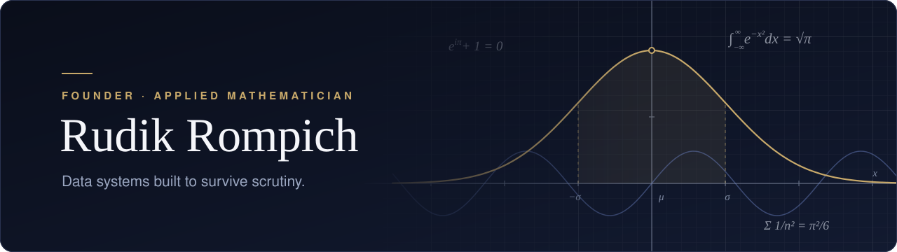
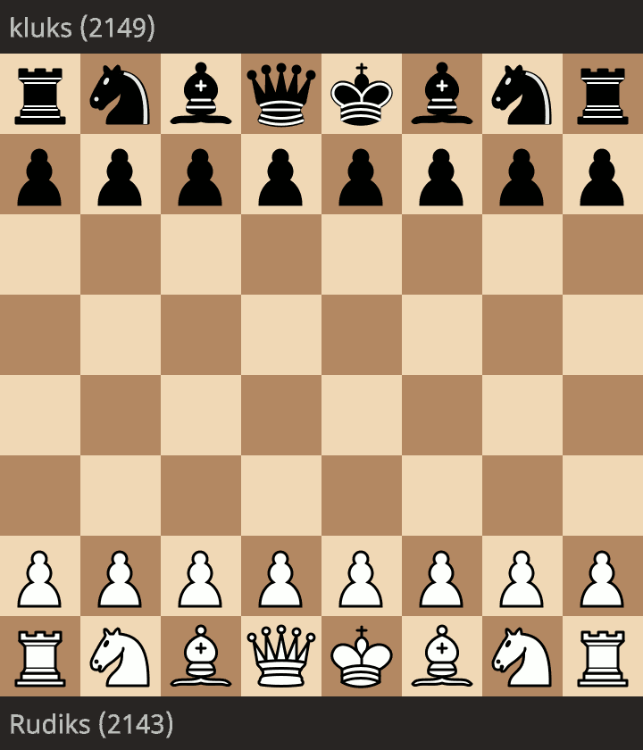

  

**I build data systems for places where a wrong number is expensive.**

[cincois.com](https://cincois.com) &nbsp;·&nbsp; [cinco.org.gt](https://cinco.org.gt) &nbsp;·&nbsp; [rudiks.com](https://rudiks.com) &nbsp;·&nbsp; [LinkedIn](https://www.linkedin.com/in/therudiks/) &nbsp;·&nbsp; [X](https://twitter.com/TheRudiks) &nbsp;·&nbsp; [Upwork](https://www.upwork.com/freelancers/~017cffbe03216e94c3)

 

I'm a founder and applied mathematician. My work lives in two places where data gets questioned hard: litigation dockets, where every claim has to be verified before it counts, and Guatemala's public record, where every figure should trace back to its source.

Two ventures, one discipline: clean data, verifiable methods, and nothing you have to take on faith.

 

## Ventures

<table>
<tr>
<td width="50%" valign="top">

 
<a href="https://cincois.com"><picture><source media="(prefers-color-scheme: dark)" srcset="assets/cincois-dark.svg" /></picture></a>

### Cinco Innovative Solutions

*Claim data that holds up.*

The data layer for high-volume litigation. Claims are verified at intake, systems are connected across the stack, and every record is built to survive scrutiny.

- **Verified Intake** Six gates on every file, signed by a named specialist.
- **Data Integration** Lead source to CRM to case management to court portal, connected and reconciled.
- **Litigation Data & Analytics** Inventory reporting, docket exposure, and lender-ready diligence.
- **Compliance Production** Fact sheets, census submissions, and deficiency cures, on the court's calendar.

AI does the checking. A person owns the outcome.

**[cincois.com →](https://cincois.com)**

</td>
<td width="50%" valign="top">

 
<a href="https://cinco.org.gt"><picture><source media="(prefers-color-scheme: dark)" srcset="assets/cinco-guatemala-dark.svg" /></picture></a>

### Cinco Guatemala

*Guatemala's data, in one place.*

Guatemala's data company. Curated series, APIs, and AI automations that turn scattered information into decisions, with sources, assumptions, and code in the open.

- **Live observatories** Remittances, inflation, Congress, public health, and elections, measured daily.
- **Inflation in real time** Around 134,000 online prices tracked every day, next to the official index.
- **Cinco Guatecompras** Public procurement from the seller's side: what is open, who you face, what is worth bidding on.
- **Data API & research** Replicable series and analysis you can cite with confidence.

Data engineering, not opinions.

**[cinco.org.gt →](https://cinco.org.gt)**

</td>
</tr>
</table>

 

## How I work

**Show the work.** Sources, assumptions, and method travel with every number, so anyone can replicate it.

**Automate the checking, not the accountability.** Machines run the gates. A named person signs the result.

**Ship it live.** A pipeline that updates itself beats a PDF that arrives once a year.

 

## Toolkit

<table>
<tr><td><b>Languages</b></td><td>Python &nbsp;·&nbsp; R &nbsp;·&nbsp; SQL &nbsp;·&nbsp; Java &nbsp;·&nbsp; JavaScript</td></tr>
<tr><td><b>Data &amp; cloud</b></td><td>Google Cloud &nbsp;·&nbsp; BigQuery &nbsp;·&nbsp; Jupyter &nbsp;·&nbsp; Git &nbsp;·&nbsp; GitHub Actions</td></tr>
<tr><td><b>Mathematics</b></td><td>LaTeX &nbsp;·&nbsp; Mathematica</td></tr>
<tr><td><b>Currently sharpening</b></td><td>Go &nbsp;·&nbsp; Swift &nbsp;·&nbsp; Kotlin</td></tr>
</table>

 

## Beyond the work

I trained as a mathematician, with a BS in Applied Mathematics from Universidad del Valle de Guatemala, and served as president of the university's chess club. I still believe the best engineering reads like a clean endgame: nothing wasted, every move with a reason.

I write about ideas, mathematics, and literature at **[rudiks.com](https://rudiks.com)**.

 

---

**Have numbers that need to hold up?**

I take on select consulting work. Reach me through [cincois.com](https://cincois.com), [LinkedIn](https://www.linkedin.com/in/therudiks/), or [Upwork](https://www.upwork.com/freelancers/~017cffbe03216e94c3).

